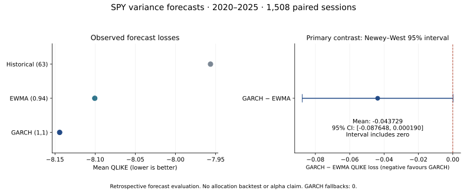

# Volatility Forecasting: Does Model Complexity Help?

**Does GARCH predict next-day SPY variance better than simple baselines, and do additional GARCH lags improve its forecasts?**

Across **1,508 paired forecast dates in 2020–2025**, GARCH(1,1) had the lowest observed average QLIKE loss. Its advantage over EWMA remained inconclusive under the predefined 95% uncertainty calculation. A separately specified exploratory extension found no improvement from GARCH(2,1) or GARCH(1,2).



This applied time-series research project demonstrates past-only forecasting, explicit statistical comparisons, failure handling and auditable results. It does not claim a novel GARCH method, a profitable trading strategy or proven alpha.

**Acknowledgment:** This project was developed with the help of AI assistance under the maintainer's direction. See [development and validation notes](CONTRIBUTIONS.md).

## Findings

### Original comparison: GARCH versus simple baselines

| Model | Mean QLIKE — lower is better |
|---|---:|
| Historical second moment, 63 sessions | −7.956398 |
| EWMA, decay 0.94 | −8.100473 |
| GARCH(1,1), Gaussian, zero mean | **−8.144203** |

The registered GARCH-minus-EWMA average loss difference was **−0.043729**, with a Newey–West 95% interval of **[−0.087648, +0.000190]**. The interval includes zero: this procedure does not establish lower expected loss. It also does not establish equivalence. QLIKE values are forecast-loss units, not percentage investment returns.

Read the [original research report](docs/results.md).

### Exploratory extension: additional lags

The baseline result was already known before this separate extension was specified. It reused the exact snapshot, target dates and stored GARCH(1,1) forecasts; the historical baseline was not refitted.

| Specification | Mean QLIKE ↓ | Difference versus GARCH(1,1) | Holm-adjusted p |
|---|---:|---:|---:|
| GARCH(1,1), frozen baseline | **−8.144203** | — | — |
| GARCH(2,1) | −8.138273 | +0.005930 | 0.430684 |
| GARCH(1,2) | −8.142855 | +0.001348 | 0.430684 |

Both added-order models had higher observed loss; neither met the predefined improvement rule. Both comparisons used the same HAC method and Holm adjustment across the two tests. This supports retaining the simpler model within this comparison, without establishing universal superiority or model equivalence.


Read the [extension report and hypotheses](docs/higher-order-extension.md). All models completed their historical targets without fallback or numerical variance floors.

## Design choices and lessons

| Choice | Purpose |
|---|---|
| Rolling historical second moment and fixed EWMA baselines | Test whether estimated complexity adds value over transparent alternatives. |
| Forecasts issued after the origin close | Fit only observed returns; never let the target return enter its own forecast. |
| Identical targets and 1,260-return GARCH windows | Keep data and estimation history comparable across GARCH orders. |
| QLIKE as the fixed primary loss | Evaluate positive variance forecasts against a noisy squared-return proxy without choosing the score after seeing outcomes. |
| Newey–West HAC uncertainty | Allow short-run serial dependence in paired loss differences, subject to asymptotic assumptions. |
| Holm adjustment for the two extension contrasts | Account for the explicitly tested comparison family. |
| Recorded EWMA fallback and retained failure dates | Prevent difficult dates disappearing from a candidate's score. |
| Separate frozen specifications and hashed artifacts | Preserve what was evaluated and distinguish the known-baseline extension from the original study. |

The main lessons are that a better observed score can remain inconclusive, extra lags need not improve forecasts, and forecast accuracy is a different question from portfolio usefulness. The protocol and decision rules were retained when the outcomes did not establish improvement.

The economic motivations for extra lags—richer short-run shock responses and persistence—remain hypotheses. These reduced-form comparisons cannot identify causal mechanisms. GARCH(1,1) already has recursive long memory; higher orders add flexibility rather than merely changing the memory from one day to two.

## Reproduce the software checks

Requires **Python 3.12** and **uv**. The project has its own environment and frozen dependency lock.

```bash
uv sync --frozen --extra dev
uv run --frozen pytest
uv run --frozen ruff check .
uv run --frozen mypy src
```

**59 offline tests** cover future-data leakage, training windows, lag notation, variance units, failed fits, fallback retention, snapshot tampering, protocol identity, Holm adjustment and exclusive outputs. The GitHub Actions workflow runs these checks and both numerical demos; these are software checks, not empirical evidence.

Run the real numerical models on synthetic observations:

```bash
uv run --frozen volatility-research demo --output reports/synthetic-demo-v1
uv run --frozen python -m volatility_research.extension --demo --output reports/higher-order-demo-v1
```

Output directories are exclusive. Use a fresh path for a repeated synthetic demo. The original demo produces 120 target dates; the extension demo compares all three GARCH orders on 40 synthetic targets. Synthetic model rankings have no market interpretation.

## Data and historical reproducibility

The accepted Yahoo Finance snapshot contains **5,283 adjusted closes from 2005–2025**. It was checked against every expected XNYS session. Returns are adjusted close-to-close log returns; the forecast target is next-session squared return under a zero-mean assumption.

Vendor prices and detailed return/forecast ledgers are **not redistributed**. The repository includes code, synthetic checks, aggregate outcomes, protocol identities and execution/audit receipts. Exact historical reconstruction additionally requires the retained matching snapshot; a fresh Yahoo download may revise historical adjusted values.

The following commands document the original workflow. The retained historical studies are already complete: do not delete their result directories to rerun them.

```bash
uv run --frozen volatility-research acquire --output data/spy-v1
uv run --frozen volatility-research evaluate --data data/spy-v1/prices.csv --output reports/spy-daily-variance-v1
uv run --frozen python -m volatility_research.extension
```

The extension requires the completed baseline ledger and its bound snapshot. Historical acquisition requires Yahoo HTTPS access and may fail as its public interface changes. Missing dates, failed models and changed snapshot identities are never silently repaired or dropped.

## Evidence and project structure

- [Original study](docs/results.md), [extension](docs/higher-order-extension.md), and [methodological assumptions](docs/research-design.md).
- [Frozen protocols](protocol/) and [aggregate evidence and receipts](docs/results/).
- [Research status](docs/STATUS.md) and [contributions](CONTRIBUTIONS.md).
- `src/volatility_research/`: estimators, scores, runners and data validation.
- `tests/`: offline synthetic and adapter tests.
- `tools/`: saved-result audits and figure rendering.

With the retained historical inputs and ledgers present, the audits reconcile artifacts without refitting:

```bash
uv run --frozen python tools/audit_run.py
uv run --frozen python tools/audit_extension.py
```

“Independent audit” here means separate calculations checking saved artifacts; it does not mean external scientific review. Public figures can be rebuilt from the aggregate JSON alone in a separate presentation environment:

```bash
uv run --no-project --isolated --with matplotlib==3.10.8 python tools/render_results.py
uv run --no-project --isolated --with matplotlib==3.10.8 python tools/render_extension.py
```

## Limits of the conclusion

This is one instrument and familiar historical data. Daily squared returns are noisy variance proxies; adjusted prices are revised rather than point-in-time records. HAC inference is asymptotic, and nested models, parameter boundaries, rolling estimation and nonstationarity complicate its interpretation. Holm adjustment covers two extension contrasts, not the wider history of research choices.

No allocation backtest, trading costs, investor utility or live execution is evaluated. Any future allocation study needs its own timing and implementation assumptions. The completed momentum research programme and its prospective data/state are separate and were not used by this project.
