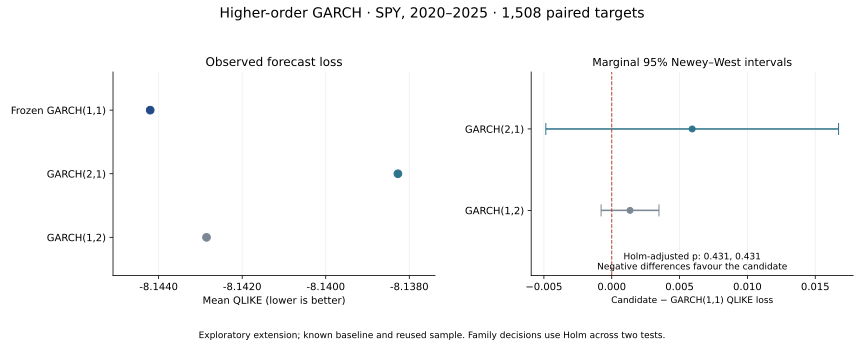

# Do additional GARCH lags improve daily variance forecasts?

Completed exploratory historical extension · 18 October 2026

## Relationship to the original study

This extension belongs to the same volatility-forecasting project but has its own frozen protocol, execution and result artifacts. It does not replace the completed [GARCH(1,1)-versus-EWMA study](results.md).

The original baseline outcome was already known when the extension was proposed. The user explicitly authorized two additional orders. The new protocol was frozen before fitting either higher-order candidate or inspecting its loss. The reused 2020–2025 historical period is therefore exploratory evidence, not a fresh confirmation sample. The original models, results and protocol remain unchanged.

## Hypotheses and economic motivation

Using the `arch` convention, p counts squared-shock lags and q counts conditional-variance lags:

| Candidate | Hypothesis | Plausible motivation |
|---|---|---|
| GARCH(2,1) | An additional direct squared-shock lag improves next-day QLIKE relative to GARCH(1,1). | News and liquidity responses may unfold across several sessions. |
| GARCH(1,2) | An additional variance lag improves next-day QLIKE relative to GARCH(1,1). | Volatility persistence may have a richer shape than the simpler recursion captures. |

GARCH(1,1) already retains past shocks recursively. Increasing the order adds flexibility to its response pattern; it does not simply extend memory from one day to two. These are reduced-form forecasting hypotheses. Even a successful candidate would not identify a causal economic mechanism from these coefficients alone.

Additional flexibility also requires more estimated parameters. Estimation noise, weak identification and near-boundary solutions can offset a better in-sample fit. The experiment asks whether that flexibility earns a forecasting improvement under otherwise identical assumptions.

## Fixed comparison

The extension reused the exact accepted SPY adjusted-close snapshot and the original 1,508 target dates. It reused the stored GARCH(1,1) forecasts without refitting them. Both new models used zero mean, Gaussian innovations, 1,260-return rolling estimation windows, daily refits, identical scaling, optimizer settings and parameter checks. Forecasts used only information available through the origin close.

An unacceptable candidate fit would retain its target date and use the original same-origin EWMA fallback. Every candidate fit was accepted: neither model needed a fallback or numerical variance floor. The new execution therefore performed 3,016 higher-order fits and zero historical baseline refits.

The primary contrasts were each candidate's QLIKE loss minus frozen GARCH(1,1) loss. Negative differences favour the candidate. Both used the original Newey-West Bartlett HAC lag rule, selecting seven lags. Two-sided asymptotic normal p-values were adjusted together using Holm's step-down procedure at family alpha 0.05. Improvement additionally required a negative mean difference and passage of the fit gate.

The reported 95% intervals are marginal intervals. They are not simultaneous family-adjusted intervals; family decisions use the Holm-adjusted p-values. The adjustment covers exactly these two comparisons, not all earlier research choices. No higher-order-versus-EWMA or GARCH(2,1)-versus-GARCH(1,2) significance test was added.

## Results

| Model | Mean QLIKE ↓ | Difference versus GARCH(1,1) ↓ | Holm-adjusted p |
|---|---:|---:|---:|
| Frozen GARCH(1,1) | −8.144203 | — | — |
| GARCH(2,1) | −8.138273 | +0.005930 | 0.430684 |
| GARCH(1,2) | −8.142855 | +0.001348 | 0.430684 |

QLIKE is a forecast-loss score, not a percentage return. Both higher-order candidates had higher observed loss than the baseline.

| Contrast | Marginal Newey-West 95% interval | Raw two-sided p | Fallbacks |
|---|---|---:|---:|
| GARCH(2,1) − GARCH(1,1) | [−0.004859, +0.016718] | 0.281361 | 0 / 1,508 |
| GARCH(1,2) − GARCH(1,1) | [−0.000784, +0.003480] | 0.215342 | 0 / 1,508 |

**Neither candidate met the predefined improvement rule.** Both point estimates were worse, both marginal intervals included zero, and both Holm-adjusted p-values exceeded 0.05. These results do not establish that either higher-order model is significantly worse, nor that the models are equivalent.

Secondary variance MSE was 3.253077 × 10⁻⁷ for frozen GARCH(1,1), 3.267030 × 10⁻⁷ for GARCH(2,1), and 3.279533 × 10⁻⁷ for GARCH(1,2). This descriptive outcome also provides no observed improvement over the baseline; it does not substitute for the primary decision rule.

## Interpretation and limitations

For this asset, sample, estimation window and loss, adding either lag did not deliver a forecasting improvement. Retaining the simpler baseline is reasonable within this comparison. The result does not show that GARCH(1,1) is universally optimal or that delayed shock responses and richer persistence never matter.

The extension addresses the usefulness of two particular statistical approximations, not the existence of their proposed economic mechanisms. One cannot conclude that markets process news immediately merely because an extra squared-shock lag failed to improve this forecast score.

The normal HAC calculations are asymptotic. Nested models, parameter boundaries, correlated forecast errors, rolling parameter estimation and nonstationarity complicate inference. Holm adjustment does not repair those assumptions or make reused history independent of earlier research decisions. Results should remain explicitly exploratory.

No sample, distribution, window, model order or statistical procedure was changed after observing the extension outcome. No trading strategy or allocation return was calculated. Further specifications would require a new research question rather than an attempt to find a statistically favourable result.

## Validation and reproducibility

Before historical execution, all 59 tests, Ruff and strict mypy passed. New tests cover lag notation, all lag coefficients in admissibility checks, future-data exclusion, exact target pairing, unchanged baseline records, fallback retention, normal-tail calculations, Holm adjustment and exclusive outputs. The real numerical models also ran in an offline synthetic demo.

An independent post-run audit reconciled the snapshot, original ledger, protocol and source hashes; every training window and target; parameter admissibility; fallback counts; mean losses and MSE; HAC intervals; normal p-values using SciPy; Holm adjustment; and the declared decisions. It did not refit models. The original study's independent audit also still passes.

- [Extension protocol](../protocol/higher-order-v1.toml) and [hash](../protocol/higher-order-v1.sha256).
- [Exact summary](results/higher-order-v1/summary.json).
- [Execution receipt](results/higher-order-v1/started.json) and [completion receipt](results/higher-order-v1/completed.json).
- [Independent audit](results/higher-order-v1/audit.json).
- [Figure PDF](figures/higher-order-comparison.pdf).

Raw vendor data and detailed forecast ledgers remain excluded from the public source package. Exact historical reconstruction requires the retained matching snapshot; a later Yahoo download can revise adjusted history.
